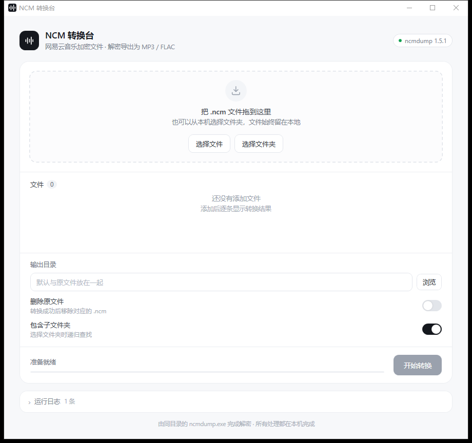
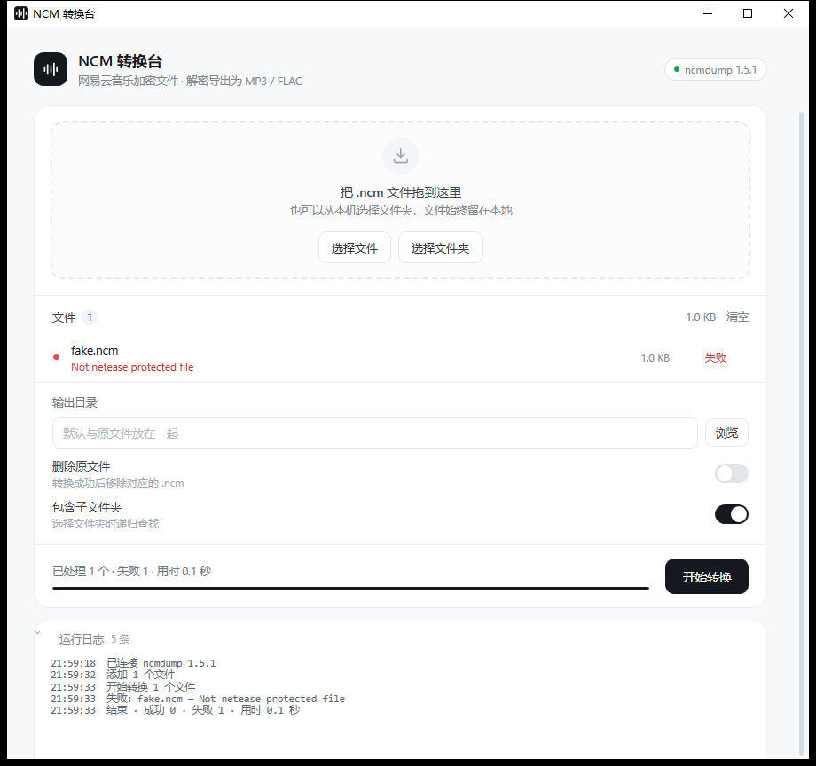

# NCM 转换台

给 [`ncmdump`](https://github.com/taurusxin/ncmdump) 做的 Windows 桌面界面：把网易云音乐下载的 `.ncm`
加密文件解密成普通 MP3 / FLAC，保留歌曲信息与封面。原生 WPF 窗口、原生拖放，全程本机处理。



> **免责声明**
> 本项目只是 `ncmdump` 的图形外壳，用于转换**你自己合法获得**的音乐文件，方便在本地播放器里使用。
> 请勿用于传播或商业用途。NCM 解密涉及绕过版权保护，仓库可能随时被平台下架，请自行备份。

## 需要自备 ncmdump

仓库不包含 `ncmdump.exe`（第三方二进制，为符合其许可与平台规则未入库）。使用前：

1. 到 [taurusxin/ncmdump Releases](https://github.com/taurusxin/ncmdump/releases) 下载 Windows 版；
2. 把 `ncmdump.exe`（和 `libncmdump.dll`，如果压缩包里有）放到 `NcmGui.exe` **同目录**；
3. 启动程序，右上角会显示 `ncmdump 1.5.1` 之类的版本号，说明已识别。

从源码构建时放在仓库根目录即可，构建会自动把它嵌进 exe。

## 运行

先按下方「构建」生成 `dist\`，然后双击 `dist\NcmGui.exe`；开发时也可以
`dotnet run --project NcmGui\NcmGui.csproj`。

需要 Windows 10/11 x64。程序是 .NET 9 自包含发布，目标机器不需要安装 .NET 运行时。
运行时请把 `ncmdump.exe` 放在 `NcmGui.exe` 同目录（见上一节）。

## 功能

- 拖放文件/文件夹到窗口，或用系统原生对话框选择
- 一个文件一行：等待 / 转换中 / 完成 / 失败，失败原因直接显示在行内
- 实时进度条、可展开的运行日志、可中途取消
- 输出目录、删除原文件、包含子文件夹，与命令行参数一一对应
- 结束后「打开输出文件夹」，或点已完成行的文件名在资源管理器中定位



## 工作原理

GUI 只做四件事：收集文件、拼参数启动 `ncmdump`、解析它的输出、展示结果。

`ncmdump` 的两个坑决定了实现方式：

- **失败时退出码仍是 0**，所以结果以输出内容和「目录里新增的音频文件」共同判断；
- 只认**小写** `.ncm`，`.NCM` 会被静默跳过，界面会直接提示改名。

## 构建

需要 .NET SDK 9：

```powershell
dotnet build NcmGui\NcmGui.csproj
dotnet run --project NcmGui\NcmGui.csproj
```

生成可分发的单文件版本（连同 WPF 的 5 个原生 DLL 一起，共 6 个文件）：

```powershell
dotnet publish NcmGui\NcmGui.csproj -c Release -r win-x64 --self-contained true `
  -p:PublishSingleFile=true -p:EnableCompressionInSingleFile=true -p:DebugType=None -o dist
```

或直接运行 `publish.bat`。

> WPF 的原生库无法打进单文件，因此产物是同目录的 6 个文件。`ncmdump.exe` 若在构建时存在，
> 会被嵌入 `NcmGui.exe`，首次运行释放到 `%LOCALAPPDATA%\NcmGui\bin\<版本>\`。

## 目录结构

```
NcmGui\
  Core\ConversionEngine.cs     调用 ncmdump、解析结果
  ViewModels\MainViewModel.cs  状态与流程
  Models\FileItem.cs           单个文件的数据
  MainWindow.xaml              界面
  Theme.xaml                   颜色、按钮、开关等样式
screenshots\                   界面截图
publish.bat                    生成 dist
```

## 第三方

- [ncmdump](https://github.com/taurusxin/ncmdump)（MIT）—— 实际完成解密与写标签
- [TagLib#](https://github.com/mono/taglib-sharp)（LGPL-2.1）—— ncmdump 内部使用

本仓库仅包含 GUI 源码，不包含上述二进制。

## License

[MIT](LICENSE)
